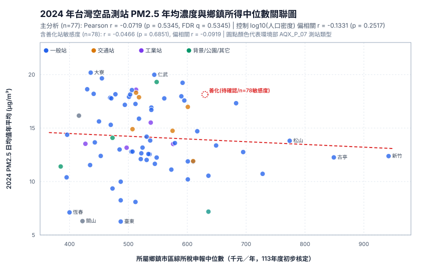
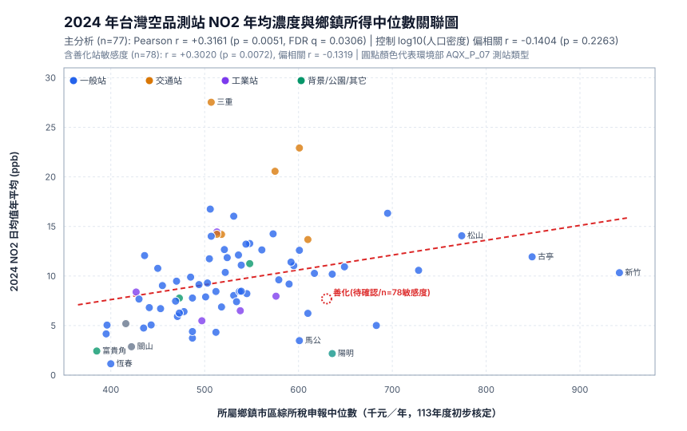
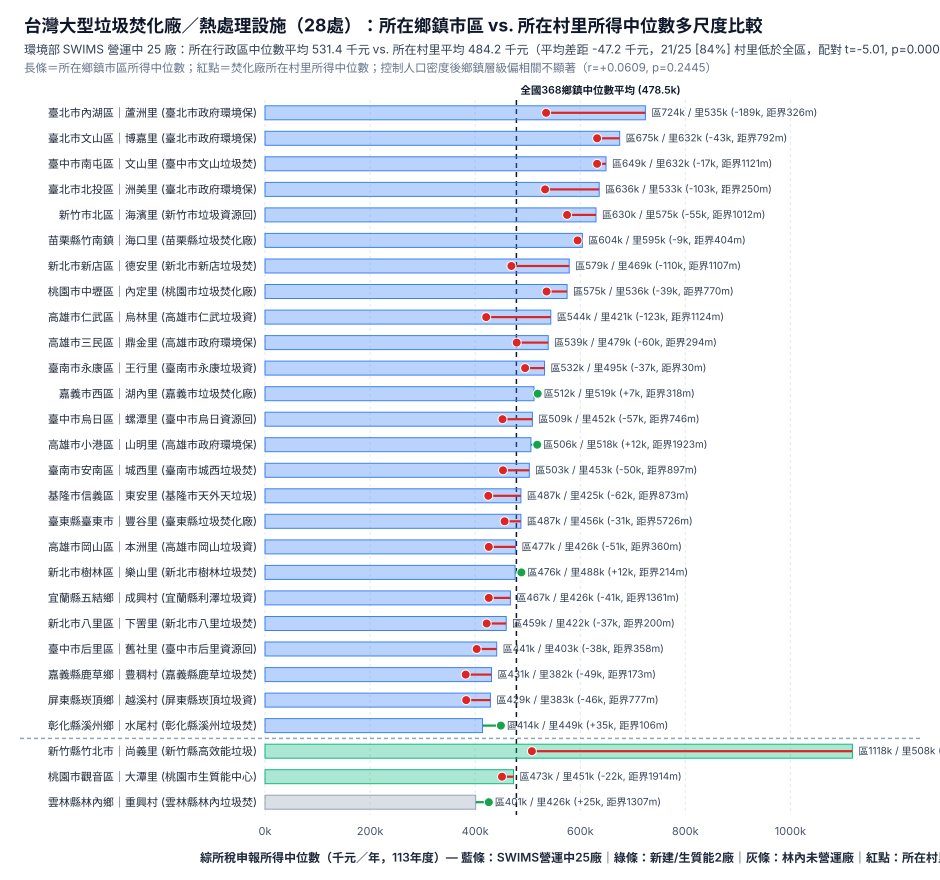

# 台灣環境正義多維度實證研究總結報告（2026-11-13 嚴格核驗修正版）

- **專案倉庫**：[`agp1p7/taiwan-environmental-justice`](https://github.com/agp1p7/taiwan-environmental-justice)
- **線上預覽地圖**：[`https://agp1p7.github.io/taiwan-environmental-justice/environment-preview/`](https://agp1p7.github.io/taiwan-environmental-justice/environment-preview/)
- **產出資料與圖表索引**：
  - 全國 368 鄉鎮市區標準化環保列管與土壤場址統計：[township_cleaned_pollution_stats.csv](../../data/township_cleaned_pollution_stats.csv)
  - 全國 28 處大型垃圾焚化廠／熱處理設施多尺度核驗清冊：[taiwan_incinerators_verified.csv](../../data/taiwan_incinerators_verified.csv) ／ [incinerators.geojson](../../environment-preview/incinerators.geojson)
  - 善化測站（`siteid: 44`）雙軌處置說明：[SHANHUA-FINAL-RESOLUTION.md](../station-mapping-review-v2/SHANHUA-FINAL-RESOLUTION.md)
  - 專題分項報告：[incinerators_environmental_justice.md](./incinerators_environmental_justice.md) ／ [cleaned_pollution_income_analysis.md](./cleaned_pollution_income_analysis.md)

---

## 1. 總體研究架構與進度盤點

本研究結合**財政部 113 年度（2024 年）初步核定綜合所得稅申報統計**（全國 **368 個鄉鎮市區**中位數與 **7,653 個有效具名村里**圖形，`income_year = 2024`）、**內政部 2024 年底人口密度**（**368/368** 鄉鎮市區，含 30 個山地原住民鄉／區），以及**環境部四大公開資料來源**，從「鄉鎮市區宏觀尺度」與「行政區內部村里微觀尺度」雙重檢驗台灣的環境負荷分配：

| 研究維度 | 資料來源與規模 | 完成狀態 | 核心計量結論摘要 |
|---|---|---|---|
| **維度一：2024 環境空氣品質**（$\text{NO}_2, \text{PM}_{2.5}, \text{SO}_2$） | 環境部 2024 測站小時值年報重算（主分析 $n=77$ 站；含善化敏感度 $n=78$ 站；僅一般站 $n=60$ 站；鄉鎮去重 $n=74$ 區） | **已完成並通過多重敏感度驗證** | 雙變量下僅 $\text{NO}_2$ 與所得正相關（$r=+0.3161, p=0.00510, q=0.0306$）；**控制 $\log_{10}(\text{人口密度})$ 後，三種污染物偏相關全數不顯著**（一般站 $\text{NO}_2$ 偏相關 $r=-0.0080, p=0.9518$）。 |
| **維度二：土壤及地下水污染控制場址公告** | 環境部 `EMS_S_07` 去重後 **8,254 筆**（有效具名村里內 **8,234 筆**：未見解除資訊 355 筆、有解除公告資訊 7,879 筆；另有 20 筆於有效具名村里界外） | **已完成（368 鄉鎮面積／人口標準化）** | 未控制密度時未見解除資訊筆數與所得呈微弱正相關（$r=+0.1473$）；**控制 $\log_{10}(\text{人口密度})$ 後偏相關為 $r=-0.0317$ ($p=0.5447$，不顯著)**。農地場址受「一地號一筆公告」影響（如彰化鹿港嚴格配對 863 筆）。 |
| **維度三：環保管理分類配對紀錄**（空／水／廢） | 環境部 `EMS_S_01` 去重且落於有效具名村里內 **256,597 筆**（空污 55,822、水污 64,518、廢清法 164,707 筆） | **已完成（修正定義與標準化）** | 此為歷史與跨分類管理紀錄（非獨立事業數，`iswaste` 為廢清法列管產源而非鄰避設施）。控制人口密度後空污紀錄偏相關消失（$r=+0.0134, p=0.7981$），廢清法與水污紀錄則反映工商業廠辦聚集。 |
| **維度四：大型垃圾焚化廠與熱處理設施選址** | 環境部 SWIMS 官方營運中 **25 廠** + 桃園生質能 BOT + 竹北 BOO + 林內未營運廠（**共 28 處，28/28 村里落點核驗**） | **已完成（揭示跨尺度 MAUP 反轉）** | **宏觀鄉鎮層級**：控制密度後設廠與鄉鎮所得無關（偏相關 $r=+0.0609, p=0.2445$）。 **微觀村里層級**：**SWIMS 25 廠有 21 座（84.0%）所在村里所得低於母區**（平均 **-47.2 千元**，配對 $t=-5.015, p=0.00004$；含新建共 27 處為 **23/27 [85.2%]**，Wilcoxon $p=0.000032$），且 **96%（24/25）位於距外區界 2 公里內**（中位數 **745.5 公尺**）。 |
| **待辦維度：河川水質污染指標（RPI）** | 環境部 `WQX_P_01`（河川水質監測資料） | **尚未執行（誠實揭露）** | 環境部開放資料 API 下載受 `MOENV_API_KEY` 與每日配額條件限制，本階段僅分析 `EMS_S_01` 水污列管紀錄，**尚未納入河川水體實測 RPI（溶氧、生化需氧量、氨氮、懸浮固體）**。 |

---

## 2. 維度一：2024 年空氣品質（$\text{NO}_2, \text{PM}_{2.5}, \text{SO}_2$）多重敏感度分析

針對測站類型混淆（交通／工業／背景站）、同鄉鎮多站重複（77 站分屬 74 個鄉鎮）與善化站（`siteid: 44`）納入與否，我們完整計算敏感度模型與 BH FDR 校正：

| 污染物 | 模型設定 | 樣本數 ($n$) | 雙變量 Pearson $r$ (95% CI) | 雙變量 $p$ 值 (FDR $q$) | Spearman $\rho$ ($p$ 值) | 控制 $\log_{10}(\text{密度})$ 偏相關 $r$ | 偏相關 $p$ 值 (FDR $q$) |
|---|---|---:|---|---|---|---|---|
| $\text{NO}_2$ | **1. 主分析（自動化排除善化）** | 77 | **+0.3161** (+0.099, +0.504) | 0.00510 ($q=0.0306$) | +0.4532 (0.00003) | **-0.1404** | 0.22631 ($q=0.3775$) |
| $\text{NO}_2$ | 2. 納入善化站（`AQX_P_07` 善化區） | 78 | **+0.3020** (+0.085, +0.491) | 0.00721 | +0.4366 (0.00006) | **-0.1319** | 0.25272 |
| $\text{NO}_2$ | **3. 僅限「一般站」（排除交通/工業/背景站）** | 60 | **+0.3877** (+0.148, +0.584) | 0.00221 | +0.4698 (0.00015) | **-0.0080** | 0.95178 |
| $\text{NO}_2$ | 4. 僅限「一般站」（含善化站） | 61 | **+0.3696** (+0.130, +0.569) | 0.00337 | +0.4503 (0.00027) | **-0.0023** | 0.98600 |
| $\text{NO}_2$ | **5. 鄉鎮去重（同鄉鎮測站取平均）** | 74 | **+0.3755** (+0.161, +0.556) | 0.00098 | +0.4917 (0.00001) | **-0.0941** | 0.42859 |
| $\text{NO}_2$ | 6. 鄉鎮去重（含善化站） | 75 | **+0.3600** (+0.145, +0.543) | 0.00151 | +0.4742 (0.00002) | **-0.0868** | 0.46187 |
| $\text{PM}_{2.5}$ | **1. 主分析（自動化排除善化）** | 77 | **-0.0719** (-0.291, +0.155) | 0.53452 ($q=0.5345$) | -0.0782 (0.49921) | **-0.1331** | 0.25168 ($q=0.3775$) |
| $\text{PM}_{2.5}$ | 2. 納入善化站（`AQX_P_07` 善化區） | 78 | **-0.0466** (-0.266, +0.178) | 0.68510 | -0.0557 (0.62814) | **-0.0919** | 0.42663 |
| $\text{PM}_{2.5}$ | **3. 僅限「一般站」（排除交通/工業/背景站）** | 60 | **-0.1009** (-0.346, +0.157) | 0.44319 | -0.1284 (0.32817) | **-0.0852** | 0.52098 |
| $\text{PM}_{2.5}$ | **5. 鄉鎮去重（同鄉鎮測站取平均）** | 74 | **-0.0495** (-0.275, +0.181) | 0.67537 | -0.0551 (0.64086) | **-0.1084** | 0.36116 |
| $\text{SO}_2$ | **1. 主分析（自動化排除善化）** | 77 | **-0.0722** (-0.291, +0.154) | 0.53244 ($q=0.5345$) | -0.0165 (0.88702) | **-0.1450** | 0.21129 ($q=0.3775$) |
| $\text{SO}_2$ | 2. 納入善化站（`AQX_P_07` 善化區） | 78 | **-0.0631** (-0.282, +0.162) | 0.58340 | -0.0064 (0.95592) | **-0.1265** | 0.27295 |
| $\text{SO}_2$ | **3. 僅限「一般站」（排除交通/工業/背景站）** | 60 | **-0.1363** (-0.377, +0.122) | 0.29908 | -0.0775 (0.55628) | **-0.1612** | 0.22266 |
| $\text{SO}_2$ | **5. 鄉鎮去重（同鄉鎮測站取平均）** | 74 | **-0.0586** (-0.283, +0.172) | 0.61972 | +0.0029 (0.98062) | **-0.1353** | 0.25359 |

- **關鍵驗證**：僅保留 **60 座「一般測站」**時，控制 $\log_{10}(\text{人口密度})$ 後之 $\text{NO}_2$ 偏相關降至 **$r = -0.0080$ ($p = 0.9518$)**，說明雙變量正相關主要來自都市化人口與交通密集度共變。
- **空間自相關限制**：空氣污染物濃度具跨區擴散之空間自相關，傳統獨立樣本假設下之標準誤會低估區間寬度；惟控制密度後所有偏相關點估計均接近零且已不顯著（$p > 0.21$），進行空間自由度調整後僅會更不顯著，不影響推論。

---

## 3. 維度二與三：368 鄉鎮市區環保管理配對紀錄（`EMS_S_01`）與土壤場址公告（`EMS_S_07`）

完整配對全國 **368/368** 鄉鎮市區後，同步以原始筆數、每平方公里密度、$\log_{10}(1+\text{筆}/\text{km}^2)$ 及每萬人筆數檢驗：

1. **空污列管紀錄（55,822 筆）與未見解除資訊土壤場址（有效村里 355 筆／含界外備援 361 筆）**：
   - 控制 $\log_{10}(\text{人口密度})$ 後，空污紀錄偏相關由 +0.2728 降至 **+0.0134 ($p = 0.7981$)**（對數每平方公里偏相關 **-0.0327, $p = 0.5327$**）；
   - 未見解除資訊土壤場址偏相關由 +0.1473 降至 **-0.0317 ($p = 0.5447$)**（對數每平方公里偏相關 **-0.0671, $p = 0.1998$**）。
2. **水污列管紀錄（64,518 筆）與廢清法列管紀錄（164,707 筆）**：
   - 水污列管紀錄之對數每平方公里偏相關為 +0.0971（$p = 0.0631$），每萬人筆數為 $r = -0.0871$；
   - 廢清法列管紀錄（`iswaste`）代表依法申報事業廢棄物產出源（工廠、醫院與研發園區），故隨工商聚集呈現正偏相關（$r = +0.2168$），絕非鄰避設施。

---

## 4. 維度四：大型垃圾焚化廠（28 處）跨尺度分析——「鄉鎮平均」掩蓋「村里邊陲化」

1. **宏觀鄉鎮層級（`N = 368`）**：SWIMS 25 廠所在 25 區所得平均（531.4 千元）高於其餘 343 鄉鎮（474.7 千元），但**控制 $\log_{10}(\text{人口密度})$ 後偏相關不再顯著（$r = +0.0609, p = 0.2445$）**。
2. **微觀村里層級（`VILLCODE`）**：在 SWIMS 25 廠內，**21 / 25 座（84.0%）**所在村里所得低於母行政區（平均差距 **-47.2 千元**，配對 $t = -5.015, p = 0.000040$，Wilcoxon $p = 0.000072$），區內百分位中位數僅 **30.2%**；納入桃園生質能與竹北廠後（27 處）則有 **23 / 27 處（85.2%）**低於母行政區（平均差距 **-67.2 千元**，Wilcoxon $p = 0.000032$）。同時，SWIMS 25 廠距離最近相鄰鄉鎮市區邊界中位數僅 **745.5 公尺**（**18/25 位於 1 公里內、24/25 位於 2 公里內**）。

