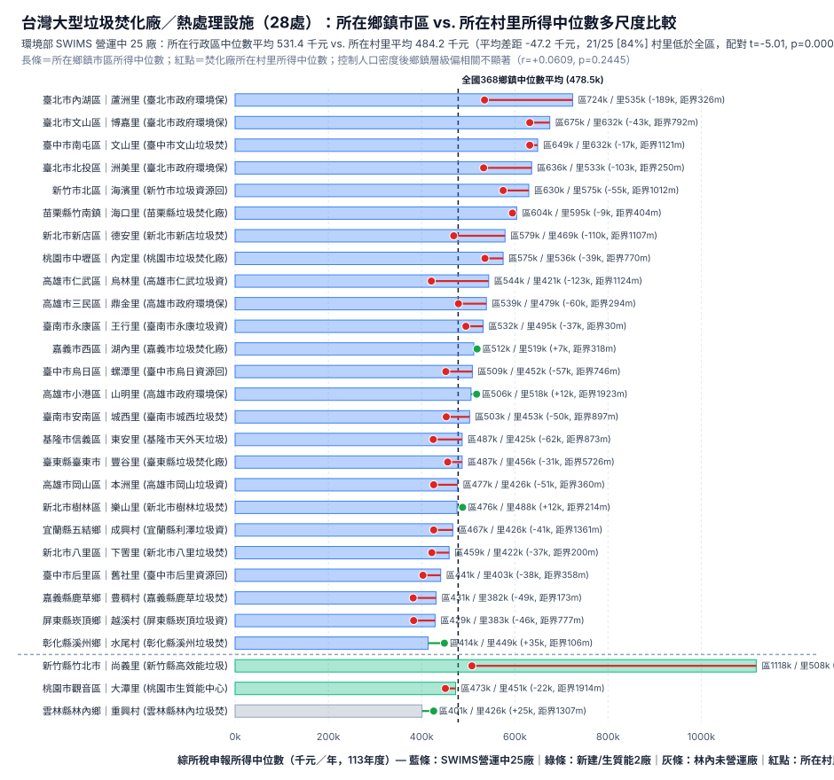

# 台灣大型垃圾焚化廠與熱處理設施（28 處）多尺度環境正義實證分析報告

- **資料基準與核驗日期**：2026-11-13
- **核心官方來源**：
  1. 環境部環境管理署「焚化廠營運管理資訊系統（SWIMS）」官方 25 座營運中焚化廠分布圖座標與編號（`https://swims.moenv.gov.tw/`，`WEPC1448`–`WEPV9500`）
  2. 環境部 SWIMS《興建營運基本資料表》（`swims_basic_info.pdf`，民國 111 年 9 月 5 日版）與各廠建廠沿革摘述
  3. 財政部 **113 年度（2024 年）初步核定綜合所得稅申報統計**（368 鄉鎮市區中位數 `township-income-source.csv` 與 7,653 具名有效村里幾何 `income.geojson`，均為 `income_year = 2024`）
  4. 內政部 2024 年底鄉鎮市區人口密度（`township-density-2024.json`，含 30 個山地原住民鄉／區，共 **368/368** 鄉鎮市區完整配對）

---

## 1. 研究問題與「可變地區單元問題（MAUP）」修正

在前一版初步探索中，僅以「鄉鎮市區（`N = 368`）」未校正平均數比較設廠與非設廠行政區所得，且早期清冊座標源自非官方摘要（造成 6 處落入鄰區、雲林林內廠行政區誤植）。本報告完成兩項根本修正：

1. **100% 官方來源與點位落區核驗（Point-in-Polygon Verification）**：全數採用環境部 SWIMS 官方系統之 25 座營運中大型垃圾焚化廠座標與編號（`WEPC1448`–`WEPV9500`），並清楚區分另外 3 處非屬傳統 SWIMS 25 廠之大型廢棄物熱處理設施（桃園觀音生質能中心 BOT、新竹竹北高效能熱處理設施 BOO、雲林林內完工未營運 BOO 廠），**共 28 處全數通過 `income.geojson` 村里多邊形落點檢驗（28/28 行政區與村里完全吻合）**。
2. **多尺度檢定與精確邊界距離量化**：同步計算（a）鄉鎮市區層級控制 `log10(人口密度)` 前後之關聯、（b）焚化廠所在**具體村里（`VILLCODE`）**與所屬**母行政區（鄉／鎮／市／區）**之配對所得差距，以及（c）廠址至最近相鄰鄉鎮市區完整多邊形線段邊界之精確最短距離（公尺）。

---

## 2. 核心實證發現（三階層統計檢定）

### 2.1 第一層：鄉鎮市區層級（未控制 vs. 控制人口密度，`N = 368`）

| 分析口徑 | 設有焚化廠行政區 | 未設焚化廠行政區 | 雙變量檢定（未控制人口密度） | 控制 $\log_{10}(\text{人口密度})$ 偏相關 |
|---|---|---|---|---|
| **環境部 SWIMS 營運中 25 廠** | $n = 25$ 鄉鎮市區 中位數平均：**531.4 千元** 群體中位數：**509.0 千元** | $n = 343$ 鄉鎮市區 中位數平均：**474.7 千元** 群體中位數：**453.0 千元** | Welch $t = 3.283$ ($p = 0.00276$) Mann-Whitney $U = 6,253$ ($z = 3.828, p = 0.00013$) 點二系列 $r = +0.1633$ ($p = 0.00167$) | **偏相關 $r = +0.0609$** **($p = 0.24451$，不顯著)** |

- **詮釋**：在未控制人口密度時，設有 SWIMS 25 座焚化廠的行政區 2024 年所得中位數平均較高（531.4 千元 vs. 474.7 千元），係因《台灣地區垃圾資源回收（焚化）廠興建工程計畫》優先服務高人口密度都會區；**一旦控制 $\log_{10}(\text{人口密度})$，鄉鎮層級設廠與否之所得差異即不顯著（偏相關 $r = +0.0609, p = 0.24451$）**。

---

## 2.2 第二層：行政區內部「所在村里 vs. 母鄉鎮市區」配對檢定（微觀環境不平等）

將空間單位細化至焚化廠實際坐落的「**村里（`VILLCODE`）**」，與所屬鄉鎮市區整體所得中位數配對比較（百分位定義為母區內所得小於或等於該里之村里佔比，並併附中位秩百分位）：

| 樣本範圍 | 設施數 ($n$) | 所屬鄉鎮市區平均 | 廠址所在村里平均 | 村里減去所屬鄉鎮平均差距 (SD) | 村里低於所屬鄉鎮比例 | 配對 $t$ 檢定 | Wilcoxon 符號等級檢定 | 區內所得百分位（中位數 / 平均） |
|---|---|---|---|---|---|---|---|---|
| **SWIMS 營運中 25 廠** | 25 | 531.4 千元 | **484.2 千元** | **-47.2 千元** (47.1k) 中位數差距 **-43.0 千元** | **21 / 25 (84.0%)** | $t = -5.015$ **$p = 0.000040$** | $W^+ = 15, W^- = 310$ $z = -3.969, \mathbf{p = 0.000072}$ | **30.2% / 36.7%** (中位秩中位 29.1%) |
| **營運／試運轉 27 處**（含桃園生質能、竹北廠） | 27 | 551.0 千元 | **483.8 千元** | **-67.2 千元** (117.7k) 中位數差距 **-43.0 千元** | **23 / 27 (85.2%)** | $t = -2.966$ **$p = 0.006395$** | $W^+ = 16, W^- = 362$ $z = -4.156, \mathbf{p = 0.000032}$ | **30.0% / 35.3%** (中位秩中位 25.0%) |
| **全清冊 28 處**（含雲林林內未營運廠） | 28 | 545.6 千元 | **481.8 千元** | **-63.9 千元** (116.8k) 中位數差距 **-42.0 千元** | **23 / 28 (82.1%)** | $t = -2.894$ **$p = 0.007436$** | $W^+ = 24, W^- = 382$ $z = -4.076, \mathbf{p = 0.000046}$ | **30.1% / 37.6%** (中位秩中位 27.1%) |

- **關鍵案例佐證**：
  - **新竹縣竹北市（新竹縣高效能垃圾熱處理設施（竹北廠））**：全區所得中位數 **1,118 千元**，而廠址所在**尚義里**僅 **508 千元**（差距 **-610 千元**，該里在區內 31 個村里中位於第 **12.9%** 分位〔中位秩 11.3%〕，距最近外區界僅 **930.4 公尺**〔鄰 新竹縣|新豐鄉〕）。
  - **臺北市內湖區（臺北市政府環境保護局內湖垃圾焚化廠）**：全區所得中位數 **724 千元**，而廠址所在**蘆洲里**僅 **535 千元**（差距 **-189 千元**，該里在區內 39 個村里中位於第 **2.6%** 分位〔中位秩 1.3%〕，距最近外區界僅 **325.5 公尺**〔鄰 臺北市|南港區〕）。
  - **高雄市仁武區（高雄市仁武垃圾資源回收(焚化)廠）**：全區所得中位數 **544 千元**，而廠址所在**烏林里**僅 **421 千元**（差距 **-123 千元**，該里在區內 16 個村里中位於第 **25.0%** 分位〔中位秩 18.8%〕，距最近外區界僅 **1,123.8 公尺**〔鄰 高雄市|大社區〕）。
  - **新北市新店區（新北市新店垃圾焚化廠）**：全區所得中位數 **579 千元**，而廠址所在**德安里**僅 **469 千元**（差距 **-110 千元**，該里在區內 69 個村里中位於第 **17.4%** 分位〔中位秩 16.7%〕，距最近外區界僅 **1,107.0 公尺**〔鄰 新北市|中和區〕）。
  - **臺北市北投區（臺北市政府環境保護局北投垃圾焚化廠）**：全區所得中位數 **636 千元**，而廠址所在**洲美里**僅 **533 千元**（差距 **-103 千元**，該里在區內 42 個村里中位於第 **14.3%** 分位〔中位秩 13.1%〕，距最近外區界僅 **249.9 公尺**〔鄰 臺北市|士林區〕）。

---

## 2.3 第三層：行政區邊界選址效應量化檢驗（精確線段距離 `dist_to_other_township_m`）

以全島村里多邊形所有頂點構成之鄰區邊界線段，計算各焚化廠至「最近不同鄉鎮市區邊界」之最短地表距離：
- **SWIMS 營運中 25 廠**：
  - 距最近相鄰鄉鎮市區邊界之**中位數距離僅 745.5 公尺**（平均距離 850.5 公尺）。
  - **18 / 25 座（72.0%）**距離相鄰行政區邊界在 **1 公里（1,000 公尺）以內**。
  - **24 / 25 座（96.0%）**距離相鄰行政區邊界在 **2 公里（2,000 公尺）以內**（唯一超過 2 公里者為臺東縣臺東市豐谷里廠址，因其轄區面積遼闊，距相鄰卑南鄉界 5,725.8 公尺，位於南側海岸線）。
- **跨界選址極端案例——臺南市永康廠（`WEPR8506`）**：
  - 永康廠法定門牌為「臺南市永康區王行東路 166 號」，廠區西側大門（`120.281500, 23.040100`）落於**永康區王行里**（495 千元，低於永康區整體 532 千元），距離最近外區界（**新化區**）僅 **30.5 公尺**；而環境部 SWIMS 地圖標記的煙囪座標（`120.282537, 23.040198`）則恰位於行政界線東側 **77.2 公尺** 處（依多邊形邊界落於**新化區北勢里**，464 千元）。

---

## 3. 方法論限制與因果詮釋警語

> [!WARNING]
> **時間先後與雙向選擇限制（Temporal Ordering & Residential Sorting）**：
> 台灣 25 座 SWIMS 大型垃圾焚化廠多於 **1987 年至 2008 年間**興建完工（臺東廠則於 2023 年啟用），而本研究所使用之鄉鎮與村里所得為 **113 年度（2024 年）初步核定**橫斷面資料。因此，所在村里所得低於母行政區（SWIMS 25 廠平均差距 -47.2 千元，$p = 0.000040$）同時反映（1）當年選址偏好地價與密度較低之河口、海岸防風林、山谷或工業邊界地段，以及（2）設廠後 20 至 30 年間都市住宅開發向核心區集中與鄰避負外部性造成的居住分選（Sorting）。橫斷面比較無法單獨切割兩者各自佔比。

---

## 4. 全台 28 處大型垃圾焚化廠與熱處理設施完整核驗清冊

以下 28 處資料均與結構化資料集 [taiwan_incinerators_verified.csv](../../data/taiwan_incinerators_verified.csv) 及圖層檔案 [incinerators.geojson](../../environment-preview/incinerators.geojson) 完全一致（所有數值皆由同一驗證管線直接輸出）：

| # | SWIMS / 識別編號 | 設施名稱 | 類別 / 狀態 | 營運方式 | 完工 / 啟用年 | 設計量 (噸/日) | 核驗行政區與村里 (`VILLCODE`) | 法定地址 | 核驗座標 (`lon, lat`) | 鄉鎮中位數 (千元) | 村里中位數 (千元) | 村里減鄉鎮 (千元) | 區內百分位 | 距外區界 (公尺 / 鄰區) |
|---:|---|---|---|---|---|---|---:|---|---|---|---:|---:|---:|---:|---:|
| 1 | `WEPC1448` | 基隆市天外天垃圾資源回收(焚化)廠 | SWIMS 25廠 / 營運中 | 公有民營 | 2005 / 2006 | 600 | 基隆市信義區東安里 (`10017070014`) | 基隆市信義區東安里培德路221之3號 | `121.774290, 25.128154` | 487 | 425 | **-62** | 10.0% | 872.9 (新北市|瑞芳區) |
| 2 | `WEPA4427` | 臺北市政府環境保護局北投垃圾焚化廠 | SWIMS 25廠 / 營運中 | 公有公營 | 1999 / 1999 | 1,800 | 臺北市北投區洲美里 (`63000120019`) | 臺北市北投區洲美里洲美街271號 | `121.499389, 25.108139` | 636 | 533 | **-103** | 14.3% | 249.9 (臺北市|士林區) |
| 3 | `WEPA4059` | 臺北市政府環境保護局木柵垃圾焚化廠 | SWIMS 25廠 / 營運中 | 公有公營 | 1989 / 1994 | 1,500 | 臺北市文山區博嘉里 (`63000080034`) | 臺北市文山區博嘉里木柵路五段53號 | `121.587890, 25.005911` | 675 | 632 | **-43** | 30.2% | 792.4 (新北市|深坑區) |
| 4 | `WEPA4244` | 臺北市政府環境保護局內湖垃圾焚化廠 | SWIMS 25廠 / 營運中 | 公有公營 | 1987 / 1992 | 900 | 臺北市內湖區蘆洲里 (`63000100037`) | 臺北市內湖區蘆洲里安康路290號 | `121.604543, 25.062299` | 724 | 535 | **-189** | 2.6% | 325.5 (臺北市|南港區) |
| 5 | `WEPF0537` | 新北市新店垃圾焚化廠 | SWIMS 25廠 / 營運中 | 公有民營 | 1991 / 1994 | 900 | 新北市新店區德安里 (`65000060017`) | 新北市新店區德安里薏仁坑路自強巷1號 | `121.496840, 24.958507` | 579 | 469 | **-110** | 17.4% | 1,107.0 (新北市|中和區) |
| 6 | `WEPF0759` | 新北市樹林垃圾焚化廠 | SWIMS 25廠 / 營運中 | 公有民營 | 1992 / 1995 | 1,350 | 新北市樹林區樂山里 (`65000070021`) | 新北市樹林區樂山里中山路三段212號 | `121.380081, 24.967421` | 476 | 488 | **+12** | 80.5% | 214.1 (新北市|鶯歌區) |
| 7 | `WEPF2314` | 新北市八里垃圾焚化廠 | SWIMS 25廠 / 營運中 | 公有民營 | 1997 / 2001 | 1,350 | 新北市八里區下罟里 (`65000230010`) | 新北市八里區下罟里中山路三段409號 | `121.368768, 25.135841` | 459 | 422 | **-37** | 30.0% | 200.2 (新北市|林口區) |
| 8 | `WEPH4335` | 桃園市垃圾焚化廠（欣榮廠） | SWIMS 25廠 / 營運中 | 民有民營(BOO) | 1999 / 2001 | 1,350 | 桃園市中壢區內定里 (`68000020027`) | 桃園市中壢區內定里松江北路16號 | `121.248979, 24.992104` | 575 | 536 | **-39** | 49.4% | 770.0 (桃園市|蘆竹區) |
| 9 | `WEPG3008` | 宜蘭縣利澤垃圾資源回收(焚化)廠 | SWIMS 25廠 / 營運中 | 公有民營 | 2002 / 2005 | 600 | 宜蘭縣五結鄉成興村 (`10002090014`) | 宜蘭縣五結鄉成興村利工二路100號 | `121.835301, 24.660115` | 467 | 426 | **-41** | 26.7% | 1,361.2 (宜蘭縣|蘇澳鎮) |
| 10 | `WEPO1732` | 新竹市垃圾資源回收廠 | SWIMS 25廠 / 營運中 | 公有民營 | 1995 / 2000 | 900 | 新竹市北區海濱里 (`10018020029`) | 新竹市北區海濱里海濱路240號 | `120.918477, 24.834767` | 630 | 575 | **-55** | 37.8% | 1,012.3 (新竹市|香山區) |
| 11 | `WEPK0322` | 苗栗縣垃圾焚化廠 | SWIMS 25廠 / 營運中 | 民有民營(BOT) | 2002 / 2008 | 500 | 苗栗縣竹南鎮海口里 (`10005040016`) | 苗栗縣竹南鎮海口里保安林25之60號 | `120.835707, 24.673522` | 604 | 595 | **-9** | 64.0% | 404.4 (苗栗縣|後龍鎮) |
| 12 | `WEPB2401` | 臺中市文山垃圾焚化廠 | SWIMS 25廠 / 營運中 | 公有民營 | 1992 / 1995 | 900 | 臺中市南屯區文山里 (`66000070007`) | 臺中市南屯區文山里文山南巷500號 | `120.598964, 24.152756` | 649 | 632 | **-17** | 52.0% | 1,120.9 (臺中市|西屯區) |
| 13 | `WEPL9232` | 臺中市后里資源回收廠 | SWIMS 25廠 / 營運中 | 公有民營 | 1996 / 2000 | 900 | 臺中市后里區舊社里 (`66000150011`) | 臺中市后里區舊社里堤防路556號 | `120.698247, 24.287838` | 441 | 403 | **-38** | 16.7% | 358.5 (臺中市|神岡區) |
| 14 | `WEPL0028` | 臺中市烏日資源回收廠 | SWIMS 25廠 / 營運中 | 民有民營(BOT) | 2001 / 2004 | 900 | 臺中市烏日區螺潭里 (`66000230013`) | 臺中市烏日區螺潭里慶光路800號 | `120.620340, 24.099798` | 509 | 452 | **-57** | 56.2% | 745.5 (彰化縣|彰化市) |
| 15 | `WEPN3259` | 彰化縣溪州垃圾焚化廠 | SWIMS 25廠 / 營運中 | 公有民營 | 1996 / 2000 | 900 | 彰化縣溪州鄉水尾村 (`10007260004`) | 彰化縣溪州鄉水尾村彰水路一段臨1號 | `120.462136, 23.827406` | 414 | 449 | **+35** | 84.2% | 106.3 (彰化縣|埤頭鄉) |
| 16 | `WEPI2617` | 嘉義市垃圾焚化廠 | SWIMS 25廠 / 營運中 | 公有民營 | 1994 / 1998 | 300 | 嘉義市西區湖內里 (`10020020049`) | 嘉義市西區湖內里湖子內路741號 | `120.441510, 23.443537` | 512 | 519 | **+7** | 63.6% | 318.0 (嘉義縣|中埔鄉) |
| 17 | `WEPQ7513` | 嘉義縣鹿草垃圾焚化廠 | SWIMS 25廠 / 營運中 | 公有民營 | 1998 / 2001 | 900 | 嘉義縣鹿草鄉豊稠村 (`10010110005`) | 嘉義縣鹿草鄉豐稠村馬稠後農場60號 | `120.279677, 23.448049` | 431 | 382 | **-49** | 6.7% | 172.9 (嘉義縣|朴子市) |
| 18 | `WEPD3244` | 臺南市城西垃圾焚化廠 | SWIMS 25廠 / 營運中 | 公有民營 | 1993 / 1999 | 900 | 臺南市安南區城西里 (`67000350031`) | 臺南市安南區城西里城西街三段1105巷121弄150號 | `120.074630, 23.045314` | 503 | 453 | **-50** | 42.9% | 897.1 (臺南市|七股區) |
| 19 | `WEPR8506` | 臺南市永康垃圾資源回收(焚化)廠 | SWIMS 25廠 / 營運中 | 公有民營 | 2003 / 2007 | 900 | 臺南市永康區王行里 (`67000310006`) | 臺南市永康區王行里王行東路166號 | `120.281500, 23.040100` | 532 | 495 | **-37** | 37.2% | 30.5 (臺南市|新化區) |
| 20 | `WEPE5004` | 高雄市政府環境保護局中區資源回收廠 | SWIMS 25廠 / 營運中 | 公有公營 | 1995 / 1999 | 900 | 高雄市三民區鼎金里 (`64000050001`) | 高雄市三民區鼎金里鼎金一巷15號 | `120.330480, 22.665553` | 539 | 479 | **-60** | 22.1% | 294.2 (高雄市|鳥松區) |
| 21 | `WEPE5641` | 高雄市政府環境保護局南區資源回收廠 | SWIMS 25廠 / 營運中 | 公有公營 | 1999 / 2000 | 1,800 | 高雄市小港區山明里 (`64000110022`) | 高雄市小港區山明里北林路6號 | `120.376429, 22.550417` | 506 | 518 | **+12** | 68.4% | 1,923.1 (高雄市|大寮區) |
| 22 | `WEPS2225` | 高雄市仁武垃圾資源回收(焚化)廠 | SWIMS 25廠 / 營運中 | 公有民營 | 1996 / 2000 | 1,350 | 高雄市仁武區烏林里 (`64000170004`) | 高雄市仁武區烏林里仁安二巷100號 | `120.369455, 22.700022` | 544 | 421 | **-123** | 25.0% | 1,123.8 (高雄市|大社區) |
| 23 | `WEPS1656` | 高雄市岡山垃圾資源回收(焚化)廠 | SWIMS 25廠 / 營運中 | 公有民營 | 1998 / 2001 | 1,350 | 高雄市岡山區本洲里 (`64000190025`) | 高雄市岡山區本洲里本工五路9號 | `120.269160, 22.816978` | 477 | 426 | **-51** | 15.2% | 359.6 (高雄市|路竹區) |
| 24 | `WEPT5929` | 屏東縣崁頂垃圾資源回收(焚化)廠 | SWIMS 25廠 / 營運中 | 公有民營 | 1997 / 2000 | 900 | 屏東縣崁頂鄉越溪村 (`10013180007`) | 屏東縣崁頂鄉越溪村中正路881號 | `120.497853, 22.499948` | 429 | 383 | **-46** | 25.0% | 777.3 (屏東縣|南州鄉) |
| 25 | `WEPV9500` | 臺東縣垃圾焚化廠（廢棄物能資源中心） | SWIMS 25廠 / 營運中 | 公有民營 | 1998 / 2005 | 300 | 臺東縣臺東市豐谷里 (`10014010039`) | 臺東縣臺東市豐谷里成都南路709號 | `121.135411, 22.731740` | 487 | 456 | **-31** | 40.0% | 5,725.8 (臺東縣|卑南鄉) |
| 26 | `NON_SWIMS_TY_BIO` | 桃園市生質能中心（榮鼎綠能） | 營運中（生質能中心） / BIOMASS_ENERGY_BOT | 民有民營(BOT) | 2019 / 2023 | 660 | 桃園市觀音區大潭里 (`68000120004`) | 桃園市觀音區大潭里環西路128號 | `121.057676, 25.032047` | 473 | 451 | **-22** | 20.8% | 1,914.4 (桃園市|新屋區) |
| 27 | `NON_SWIMS_HC_BOO` | 新竹縣高效能垃圾熱處理設施（竹北廠） | 試運轉／新啟用 / NEW_BOO_2025 | 民有民營(BOO) | 2021 / 2024 | 500 | 新竹縣竹北市尚義里 (`10004010020`) | 新竹縣竹北市尚義里拔子窟（台61線鳳鼻隧道南側） | `120.953263, 24.872663` | 1118 | 508 | **-610** | 12.9% | 930.4 (新竹縣|新豐鄉) |
| 28 | `NON_SWIMS_YL_BOO` | 雲林縣林內垃圾焚化廠（完工未營運） | 完工未營運 / UNOPERATED_BOO | 民有民營(BOO) | 2002 / 2005 | 600 | 雲林縣林內鄉重興村 (`10009100010`) | 雲林縣林內鄉重興村進興路一帶 | `120.602948, 23.779336` | 401 | 426 | **+25** | 100.0% | 1,306.9 (彰化縣|二水鄉) |

> 註：#25 臺東廠興建面積未列於 SWIMS《興建營運基本資料表》且未另外採信未具名來源；#26–#28 非傳統 SWIMS 25 廠之部分未公開單爐／裝置容量／煙囪細項亦保留為空值（`null`），僅納入已查證之公開官方規格。

---

## 5. 多尺度所得比較視覺化

